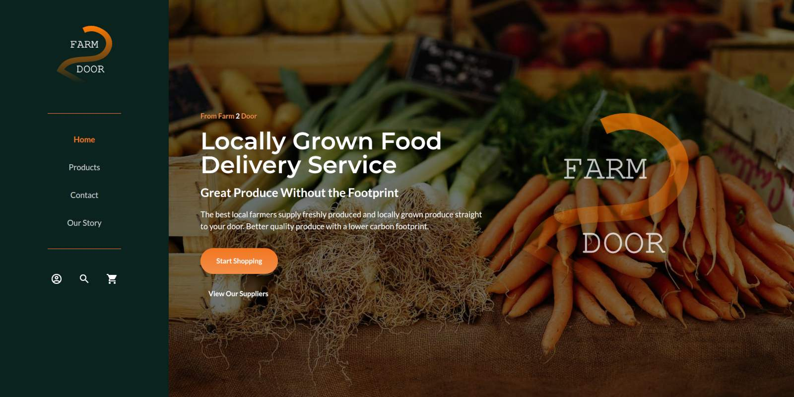

## The Storefront API

When looking into possible ecommerce frameworks, it is hard not to stumble across Shopify. Over the past 5 to 10 years it has become a bit of a monster when it comes to the online shopping space. What has also been encouraging is that they have continued to innovate and lead the way in terms of development, and were quick to move with the times as the JAMstack trend took hold.

The Storefront API allows access to the ecommerce store & product data via a GraphQL API which allows you to request precisely the information that you require to construct the page, keeping everything as lightweight as possible. In addition to this it handles customer authentication.

### What we'll build

I wanted to test [Shopify's Storefront API](https://shopify.dev/api/storefront), so came up with a simple ecommerce grocery store idea to test the API.

The beauty of this architecture is that you are able to access your store data through multiple channels (websites, apps, POS devices) whilst retaining the ability to manage your stores backend using Shopify's familiar and well-tested platform.



### The Frontend

For the frontend (website) I chose to use NuxtJS, however a similar approach could be taken with anu modern frontend web framework. With Nuxt I am able to choose whether to make the website a static site (pre-built and server as static pages) or server rendered (pages are constructed on every request). For this example I will be choosing to create a static build of the site which means it can be hosted for free and will be very fast.

I styled the site a little using Tailwind css but we will not be going into the detail of that here. Tailwind was good for quickly creating a responsive website that doesn't look totally awful.

The first step was to install a fresh version of NuxtJS and including tailwind.

```bash

npx create-nuxt-app farm-foods-store

cd farm-foods-store
npm install

```

With Nuxt installed we then need to add the node shopify api library to enable us to easily interact with the Storefront API.

```bash

npm install @shopify/shopify-api

```

### Setting Up The Shopify Store

First we need to create a Shopify Store to work with. Sign up or login to [Shopify](https://shopify.com) and create a new development store. Follow the setup guide to give the store a name, location and contact details and prompted to add some products.

Once the store is created and we have some products to work with, we need to create a Private App to enable us to interact with the API securely. Enter your newly created store admin site and open the settings menu and select Apps and sales channels -> App development and Create an App.

We give the new private app a name (e.g Storefront API) and scroll down to the Storefront API section. Check the box to allow the app to access storefront data and ensure that all subsequent permissions are checked. At the bottom of this section we can find the Storefront Access Token that we need to allow our website to access the API.

### Hook Up Our Website To The API

Now we have an access token for the Storefront API we need to give Nuxt the credentials needed to communicate with our stores backend. In the root of our Nuxt project create a .env file and include the following....

```bash
// .env

NUXT_STORE_URL=https://<the-store-name>.myshopify.com
NUXT_STORE_API_ENDPOINT=https://<the-store-name>.myshopify.com/api/2021-10/graphql.json
NUXT_STORE_ACCESS_TOKEN=<access token created in the previous step>

```

Nuxt automatically pulls in the environment variables from the .env file but we do need to make them accessible by the frontend of the site. This is easily achieved using Nuxt's publicRuntimeConfig, values that can be access from the client side of the website. In the nuxt.config.js we can add the environment variables to the publicRuntimeConfig.

```javascript
// nuxt.config.js

const storeUrl = process.env.NUXT_STORE_URL;
const storeAPIEndpoint = process.env.NUXT_STORE_API_ENDPOINT;
const storeAccessToken = process.env.NUXT_STORE_ACCESS_TOKEN;

export default {
  ...
  publicRuntimeConfig: {
    storeUrl,
    storeAPIEndpoint,
    storeAccessToken,
  },
  ...
};
```

### The Last Piece of the Jigsaw

#### Connecting to the Shopify API

We have one final thing to do to enable requests to be made to the Shopify GraphQL API. We have installed the Shopify API library but we still need to give the site access to it and instantiate a client with the store API credentials.

What we will do is create a [Nuxt plugin](https://nuxtjs.org/docs/directory-structure/plugins) to instantiate the client and then inject it into the Vue instance so we can call the API from anywhere within our application. Thanks to the Nuxt publicRuntimeConfig, we can access all the environment variables that we previously set up using the `$config` property passed to the plugin.

```javascript
// ~/plugins/shopify.js

export default ({ app: { $config } }, inject) => {
  const client = function(query, variables) {
    return fetch($config.storeAPIEndpoint, {
      method: "POST",
      headers: {
        "Content-Type": "application/json",
        "X-Shopify-Storefront-Access-Token": $config.storeAccessToken,
      },
      body: JSON.stringify({ query, variables: variables || null }),
    });
  };
  inject("client", client);
};
```

As you can see we are setting up the client request with the necessary headers and passing in the GraphQL query and variables. Finally we inject the client function into the application context making it accessible using the app contexts `$client` property.

Finally, let's make a request to the API from the products page asyncData method.

```javascript
// ~/pages/products.vue
export default {
  async asyncData({ $client }) {
    const query = `
      {
        products (first: 3) {
          edges {
            node {
              title
              productType
              description
            }
          }
        }
      }
    `;

    const {
      data: { products },
    } = await $client(query).then((res) => res.json());

    /**  Shopify Storefront API Response
      {
        "data": {
          "products": {
            "edges": [
              {
                "node": {
                  "title": "Carrots",
                  "productType": "Fresh & Frozen Vegetables",
                  "description": "Fresh Carrots. Very Orange"
                }
              },
              {
                "node": {
                  "title": "Broccoli",
                  "productType": "Fresh & Frozen Vegetables",
                  "description": "Fresh Broccoli. Very Green"
                }
              },
              {
                "node": {
                  "title": "Cauliflower",
                  "productType": "Fresh & Frozen Vegetables",
                  "description": "Fresh Cauliflower. Very Tasty"
                }
              }
            ]
          }
        }
      },
    **/

    return { products };
  },
};
```

The asyncData method will only be called during the build process of our static site and will make all the data returned in the response available to the page component and we can create and style the page however we would like.

This approach of consuming Shopify ecommerce data really gives you limitless options when it comes to your UI and customer journey as well as providing customers with a fast and secure online shopping experience.

View the half finished test [Farm Foods Store website](https://farm-foods-store.netlify.app/)

If you would like to discuss your e-commerce project please do [get in touch](/contact/).
