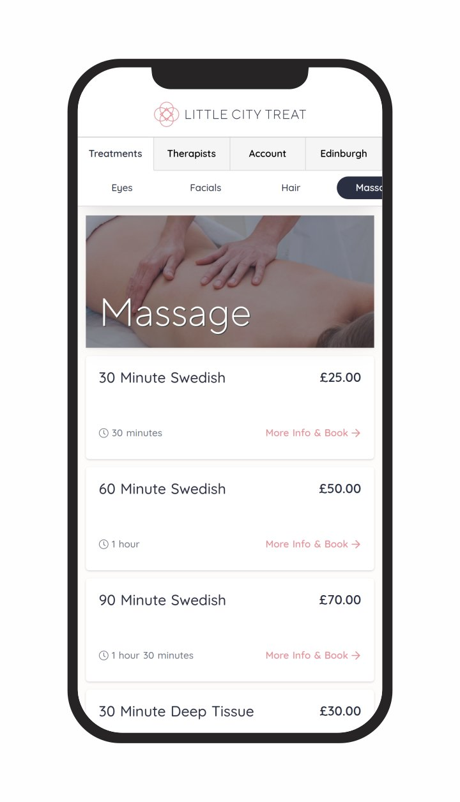

#### Booking System for Edinburgh Mobile Beauty Therapists

I was asked to create a bespoke booking system for a provider of [mobile hairdressing & beauty
treatments in Edinburgh and Newcastle](https://www.littlecitytreat.com). The company
allows self-employed Beauty Professionals to set their own availability whose
availability then feeds into the online booking system for the customers to book.

The project had three individual aspects; the client facing website with integrated
booking system and payment gateway, an application for the Beauty Professionals to
manage their availability, calendar and earnings, and the administrator
application to allow overall management of all aspects of the system.

There are a lot of third party online booking systems available however all of them were a
little too rigid for our requirements and tend to feel as though they have been
shoehorned into a site.

It was important that the booking process be easy to use, fast and secure. After
much consultation the process was finalised allowing customers to select their desired
treatments and choose by either date or therapist before confirming the booking and
completing payment. Payment is made directly to the Service Provider through Stripe,
and an application fee is taken for the booking.

There is also an e-commerce aspect of the site, initially to sell Gift Cards to be used in the
booking system, but can easily be expanded to sell additional products if required.

The entire application is written as a static site using the Nuxt JS framework. Business
logic is handled using serverless functions meaning that costs were kept low and
the other required applications could be seamlessly integrated into the system.

Progressive Web App implementation means that users can get an native app experience
when using the booking system including notifications.

Little City Treat Edinburgh launched in Edinburgh at the start of 2020 and has
now expanded to Newcastle.

You can view the site and booking system at the following links - [Little City Treat Beauty Website](https://www.littlecitytreat.com) and [Beauty Booking System](https://book.littlecitytreat.com)
