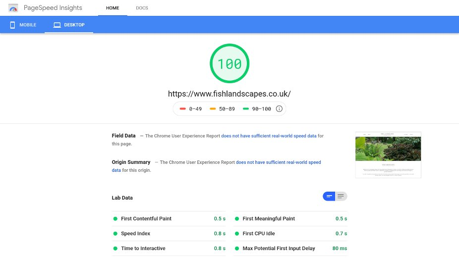

Fish Landscapes is a [landscaping design and construction company in Cumbria](https://www.fishlandscapes.co.uk/). They
required a simple site to give them there first presence on the web, and show off
some of their previous work.

The site did not require any frequent updates and therefore was best suited to
a lightweight static site rather. This meant that we were able to acheive fast
loading as well as host the site for free on [Netlify](https://netlify.com/).

The owner of the company was also the owner of Granite Setts Direct, who supply
granite setts and kerbs online, and they wanted the design to fit into that of
their other company.

A simple and uncluttered design taking colour from the images provided by the
client gave them the look and feel that they felt fitted their business.

#### PageSpeed Test Results

