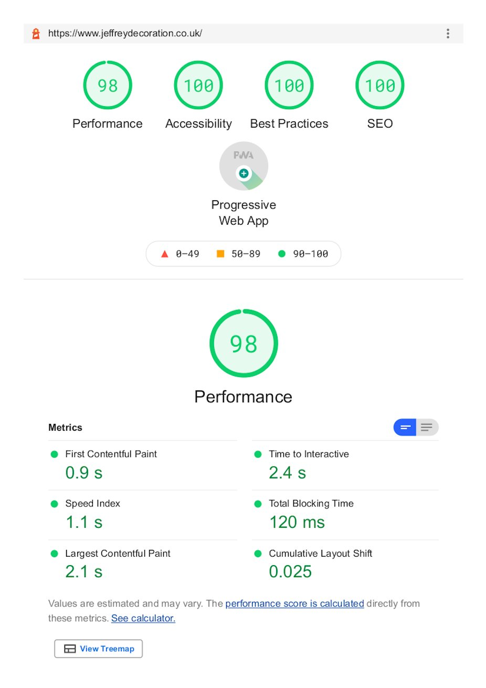

Jeffrey Decoration is a [painter and decorators in East Lothian](https://www.jeffreydecoration.co.uk) and
were looking for a simple brochure website to be visible to local customers and
allow existing customers to easily contact them. The original site was created
in 2015 so they were also looking to modernise the look and feel of the site.

There was no requirement for any additional functionality other that a contact
form for customers to request a quotation.

I developed the website using NuxtJS to generate the static pages, along with
DatoCMS Headless Content Management System to easily update and expand the site
in the future.

Using this architecture to build the site, we were able to acheive very fast
page loading speeds as well, host the site for free on [Netlify](https://netlify.com/),
and as website content updates would be relatively infrequent, the Content
Management System was also free as it was well within DatoCMS's free tier.

You can view the Lighthouse test results for the website below.

#### Lighthouse PageSpeed Test Results

